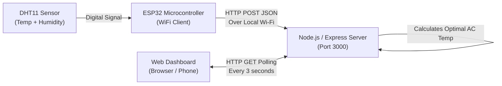

# Smart AC Temperature Recommendation System Using IoT

An IoT-based intelligent climate advisor that monitors room temperature and humidity using an **ESP32** microcontroller and **DHT11** sensor, calculates an optimal, energy-efficient AC temperature setting using threshold-based rules, and displays live multi-room climate recommendations on a responsive web dashboard.

> **Important Note:** This system is an advisory tool that **recommends** optimal AC temperatures based on environmental comfort and energy efficiency. It does **not** physically control the air conditioning unit.

---

## 🌟 Key Features

- **Real-Time Environmental Monitoring**: Reads live ambient temperature (°C) and relative humidity (% RH) from a physical DHT11 sensor every 3 seconds.
- **Dual-Parameter Recommendation Engine**: Evaluates room temperature combined with a humidity offset (Heat Index principle) to calculate target AC cooling settings.
- **Multi-Room Support ("Create Room")**:
  - **Primary Room (Living Room)**: Displays genuine real-time data from the physical ESP32 sensor.
  - **Custom Rooms (Bedroom, Study, etc.)**: Create and delete virtual rooms displaying clearly labeled simulated demo readings with natural micro-fluctuations.
  - Built-in validation prevents empty or duplicate room names.
- **Live Auto-Refreshing Dashboard**: Lightweight Vanilla HTML/CSS/JavaScript web dashboard that refreshes asynchronously every 3 seconds without reloading the page.
- **Hardware Connection Heartbeat**: Automatically detects and reflects ESP32 connectivity status (`CONNECTED` vs. `DISCONNECTED` after 15 seconds of inactivity).
- **Zero Heavy Dependencies**: Pure Node.js + Express backend with in-memory storage (no database, Docker, or complex cloud setup required).

---

## 📐 System Architecture



---

## 🌡️ Recommendation Rules (Logic Explanation)

The system employs a two-tier, explainable threshold algorithm:

### Tier 1: Baseline Temperature Rules
| Measured Room Temperature | Baseline Recommended AC | Mode / Intent |
| :--- | :---: | :--- |
| **$\ge$ 35°C** | **22°C** | High Cooling (Extreme heat) |
| **30°C to 34.9°C** | **24°C** | Moderate Cooling (Standard comfort) |
| **27°C to 29.9°C** | **25°C** | Standard Comfort (Balanced energy) |
| **$<$ 27°C** | **26°C** | Energy Saver (Mild ambient room) |

### Tier 2: Humidity Offset Adjustment (Heat Index)
- **Why?** At high relative humidity ($\ge 60\%$ RH), sweat evaporation slows down, making the room feel significantly muggier and warmer than the dry thermometer reading.
- **Rule:** If **Humidity $\ge$ 60%**, the system lowers the recommended AC temperature by **1°C** (safety floor at 21°C) to accelerate cooling and dehumidification.

#### Example Scenarios:
- **32.0°C @ 50% RH** $\rightarrow$ Baseline: 24°C $\rightarrow$ **Final Recommendation: 24°C**
- **32.0°C @ 72% RH** $\rightarrow$ Baseline: 24°C $\rightarrow$ High humidity adjustment (-1°C) $\rightarrow$ **Final Recommendation: 23°C**
- **28.5°C @ 55% RH** $\rightarrow$ Baseline: 25°C $\rightarrow$ **Final Recommendation: 25°C**
- **28.5°C @ 68% RH** $\rightarrow$ Baseline: 25°C $\rightarrow$ High humidity adjustment (-1°C) $\rightarrow$ **Final Recommendation: 24°C**

---

## 🔌 Hardware Circuit & Pinout

| DHT11 Pin | Label | ESP32 Pin | Description |
| :---: | :---: | :---: | :--- |
| **Pin 1** | **VCC** (`+`) | **3V3** or **VIN (5V)** | Power supply |
| **Pin 2** | **DATA** (`OUT` / `S`) | **GPIO 4** (D4) | Digital communication signal |
| **Pin 3** | **GND** (`-`) | **GND** | Ground |

---

## 📁 Project Structure

```text
Smart_AC_Temperature_Recommendation_System/
├── backend/
│   ├── package.json         # Node.js dependencies (express, cors)
│   └── server.js            # Express server, recommendation logic, API routes
├── frontend/
│   ├── index.html           # Dashboard layout and modal structure
│   ├── style.css            # Responsive blue-and-white theme styling
│   └── script.js            # Frontend DOM updater, API fetch, room management
├── esp32/
│   └── smart_ac/
│       └── smart_ac.ino     # ESP32 C++ firmware for WiFi & DHT11 readings
├── .gitignore
└── README.md
```

---

## 🚀 Getting Started

### 1. Prerequisites
- **Laptop / PC** with [Node.js (LTS)](https://nodejs.org/) installed.
- [Arduino IDE 2.x](https://www.arduino.cc/en/software) installed with the **ESP32 board package** (`esp32 by Espressif`).
- Arduino Library: **DHT sensor library** by Adafruit (with `Adafruit Unified Sensor`).
- **ESP32 development board** and **DHT11 sensor**.

---

### 2. Backend Setup
1. Open a terminal (Command Prompt or PowerShell) and navigate to the `backend` folder:
   ```bash
   cd "Smart_AC_Temperature_Recommendation_System/backend"
   ```
2. Install dependencies (if running for the first time):
   ```bash
   npm install
   ```
3. Start the Express server:
   ```bash
   node server.js
   ```
4. The server will start and listen on port 3000:
   ```text
   =================================================
    Smart AC Backend Server running on Port 3000
    Local access: http://localhost:3000
   =================================================
   ```

---

### 3. ESP32 Firmware Setup
1. Connect both your laptop and ESP32 to the **same Wi-Fi network** (e.g., your smartphone's 2.4 GHz mobile hotspot).
2. Find your laptop's local IPv4 address by opening Command Prompt and running:
   ```cmd
   ipconfig
   ```
   *(Look for **IPv4 Address** under `Wireless LAN adapter Wi-Fi`, e.g., `10.190.163.70` or `192.168.1.x`).*
3. Open `esp32/smart_ac/smart_ac.ino` in Arduino IDE.
4. Update lines 18–23 with your Wi-Fi credentials and laptop IP:
   ```cpp
   const char* ssid = "YOUR_WIFI_NAME";
   const char* password = "YOUR_WIFI_PASSWORD";
   const char* serverUrl = "http://YOUR_LAPTOP_IP:3000/api/temperature";
   ```
5. Select your board (**Tools** $\rightarrow$ **Board** $\rightarrow$ **ESP32 Dev Module**) and correct **COM Port**.
6. Click **Upload** (`→`).

---

### 4. Viewing the Dashboard
Open your web browser and navigate to:
```text
http://localhost:3000
```
*(You can also open `http://YOUR_LAPTOP_IP:3000` on any smartphone connected to the same Wi-Fi hotspot to view the live dashboard on mobile!)*

---

## 📡 REST API Documentation

| Method | Endpoint | Description | Request Body / Parameters |
| :--- | :--- | :--- | :--- |
| `POST` | `/api/temperature` | Ingests real-time reading from ESP32 | `{"temperature": 29.5, "humidity": 65.0}` |
| `GET` | `/api/recommendation` | Returns latest global recommendation | *None* |
| `GET` | `/api/rooms` | Lists all monitored rooms (live & simulated) | *None* |
| `POST` | `/api/rooms` | Creates a new simulated room | `{"name": "Study Room"}` |
| `DELETE` | `/api/rooms/:id` | Deletes a custom simulated room | `roomId` in URL (primary room cannot be deleted) |

---

## 🔍 Demonstration & Testing Checklist

- **Sensor Warmth / Humidity Test**: Breathe warmly onto the blue DHT11 sensor. Watch temperature and humidity rise in real time on the Living Room card, triggering cooler AC recommendations.
- **Simulate Manual Room**: Click **+ Create Room**, enter "Guest Bedroom", and observe simulated multi-zone data alongside real sensor data.
- **Validation Test**: Try submitting an empty name or duplicate room name to verify error alerts.
- **Heartbeat Disconnection Test**: Unplug the ESP32. After 15 seconds, the status badge turns red (`DISCONNECTED`). Plug it back in to watch it switch back to green (`CONNECTED`).

---

## 📄 License
This project is open-source and developed for educational and academic demonstration purposes.

